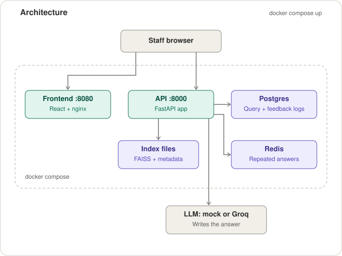
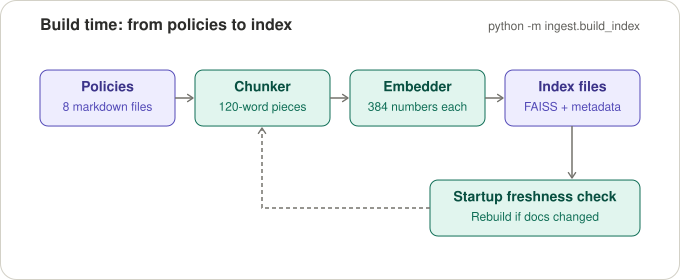
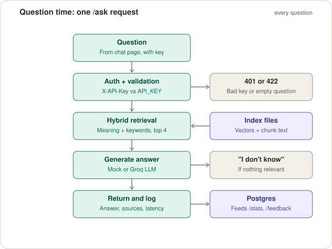
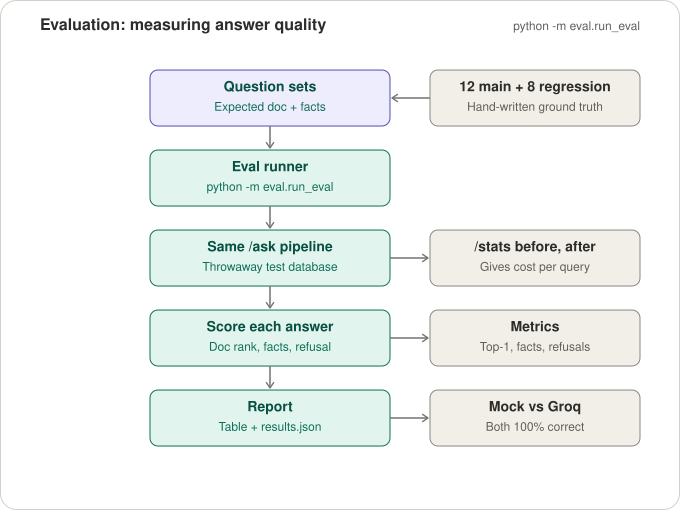
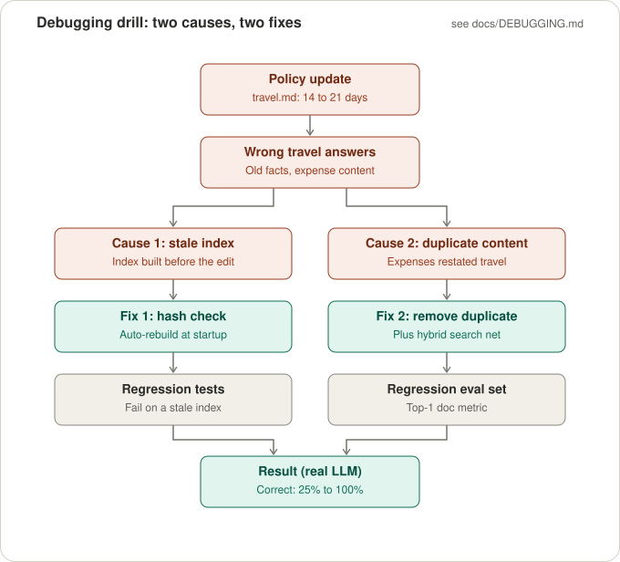
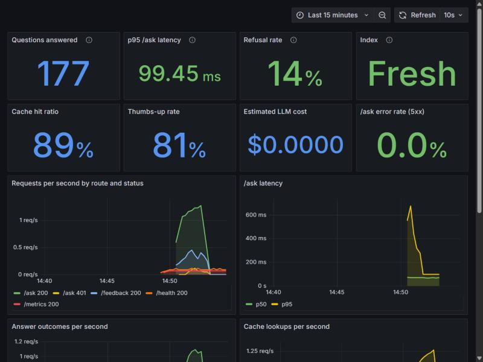

# Northwind Facilities Helpdesk

**Ask a question about company policy. Get an answer grounded in the policy documents, with its sources, or an honest "I don't know".**

[](https://github.com/Frpratik/La-Esfera-Takehome-Assignment/actions/workflows/ci.yml)


An internal helpdesk assistant for **Northwind Facilities**, a mid-sized property management firm. Staff ask things like *"How many days notice do I need for annual leave?"* or *"Who approves a laptop replacement?"* and get answers drawn only from 8 short policy documents.

It is a small, complete RAG service: ingestion pipeline, FastAPI backend, a chat UI, a SQL store for logs and feedback, a one-command Docker deployment, an evaluation harness, and a documented debugging drill. All data is synthetic.

## At a glance

| What | Result |
|---|---|
| **Answer correctness** (12-question eval) | **100%** with the offline mock and with a real LLM (Groq `openai/gpt-oss-20b`) |
| **Refusals** on unanswerable questions | **100%** say exactly "I don't know" |
| **Cost and latency** on the real LLM | about **$0.0001** and **1.8 s** per question |
| **Repeated questions** (Redis cache) | **1.2 s → 11 ms** on the real LLM, and $0 per repeat |
| **Debugging drill** (travel policy incident) | real-LLM correctness **25% → 100%** after two root-cause fixes |
| **Deployment** | `docker compose up --build`: API, chat UI and Postgres, health-checked |

## Contents

- [Architecture](#architecture)
- [How it works](#how-it-works)
- [Quick start](#quick-start)
- [API](#api)
- [Configuration](#configuration)
- [Evaluation](#evaluation)
- [Debugging drill](#debugging-drill)
- [Observability, caching and CI](#observability-caching-and-ci)
- [Design note](#design-note)
- [Project structure](#project-structure)
- [Local development](#local-development)
- [Known limitations](#known-limitations)

## Architecture



- **Frontend** (React + TypeScript, served by nginx): chat history, loading and error states, source citations, 👍/👎 feedback.
- **API** (FastAPI): `/ask`, `/feedback`, `/stats` (protected by an `X-API-Key` header), plus `/health` and Prometheus `/metrics`.
- **Index files** (FAISS + `metadata.json`): the searchable knowledge. Vectors, chunk text and a fingerprint of every policy.
- **Postgres**: the logs. One row per question (answer, sources, latency, tokens, cost) and one per rating.
- **Redis**: an optional cache that answers repeated questions without retrieval or an LLM call (on in Docker).
- **LLM**: an offline deterministic **mock** by default, or any **OpenAI-compatible** provider (Groq, Ollama) behind the same interface.

## How it works

### Build time: from policies to a searchable index



1. **Policies**: 8 markdown files in `data/policies/` (leave, expenses, IT equipment, remote work, security, onboarding, travel, incident reporting), 200–400 words each with distinct facts.
2. **Chunking**: **120 words per chunk, 30 words (25%) overlap**, giving 27 chunks.
   - *Why 120:* policy sections are about 40–60 words, so a chunk holds one or two topics. All-MiniLM-L6-v2 truncates at 256 word-pieces, and 120 words is roughly 160 tokens, safely under the cap. Smaller chunks dilute the answer; larger ones mix topics and lower precision.
   - *Why 30 overlap:* a fact cut by a chunk boundary still appears whole in the neighbouring chunk, provided the sentence is shorter than the overlap. More overlap mostly adds duplicate chunks.
3. **Embedding**: `sentence-transformers/all-MiniLM-L6-v2`, free and local, turns each chunk into 384 numbers. A deterministic hashing embedder is the offline fallback (used by the tests, or when the model can't be downloaded).
4. **Index**: FAISS `IndexFlatIP` over unit vectors (inner product = cosine similarity), plus `metadata.json` with chunk text, the embedder name, chunk settings and a SHA-256 per document.
5. **Freshness**: at API startup the stored fingerprints are compared with the files on disk. A changed policy is logged, reported by `/health` as `"stale"`, and rebuilt automatically (`AUTO_REBUILD_INDEX=true`).

### Question time: one `/ask` request



- **Hybrid retrieval**: dense similarity (meaning) and BM25 (exact words like "TravelDesk" vs "ExpenseHub") are merged with Reciprocal Rank Fusion; the top 4 chunks are kept.
- **Grounded prompt**: *answer only from the context, cite sources like `[travel-1]`, otherwise reply exactly "I don't know"*.
- **Refusal gate**: when the best similarity is below the threshold (0.35 for MiniLM), the mock says "I don't know" instead of guessing.
- **Logging**: every request stores the answer, sources, top score, latency, token counts and estimated cost, and returns a `query_id` the UI uses for feedback.

## Quick start

Requires Docker with Compose v2. No API keys or internet are needed at runtime: the default LLM is the offline mock.

```bash
cp .env.example .env
docker compose up --build
```

| Service | URL |
|---|---|
| Chat UI | http://localhost:8080 |
| API + interactive docs | http://localhost:8000/docs |
| Prometheus metrics | http://localhost:8000/metrics |
| Postgres, Redis | internal only (`postgres:5432`, `redis:6379`) |

Add dashboards with `docker compose --profile monitoring up -d`: **Grafana** at http://localhost:3000 and **Prometheus** at http://localhost:9090 (see [Observability](#observability-caching-and-ci)).

Try it from a terminal:

```bash
curl -s -X POST localhost:8000/ask -H "Content-Type: application/json" \
  -H "X-API-Key: change-me" -d '{"question":"What is the hotel limit per night?"}'
curl -s localhost:8000/stats -H "X-API-Key: change-me"
```

Startup order: Postgres becomes healthy, then the API starts (the FAISS index and the MiniLM model are baked into the image), then the frontend starts once the API reports healthy.

**Use a real LLM.** In `.env` set `LLM_PROVIDER=openai` and `LLM_API_KEY`. The defaults point at Groq with `openai/gpt-oss-20b`; for Ollama set `LLM_BASE_URL=http://host.docker.internal:11434/v1` and its model name. For cost tracking set `PRICE_PER_1K_PROMPT=0.000075` and `PRICE_PER_1K_COMPLETION=0.0003` (Groq's published gpt-oss-20b prices). Then run `docker compose up -d --build api`. The client retries rate limits (HTTP 429) with backoff.

Good to know:

- **Changing `API_KEY` or `PUBLIC_API_URL`:** the frontend bakes them in at build time, so rebuild it with `docker compose up -d --build frontend`.
- **Offline build:** the image downloads MiniLM at build time. If that fails, the build continues and the index uses the hash embedder (a warning is printed).
- **Reset data:** `docker compose down -v` also removes the Postgres volume.

## API

| Endpoint | Auth | Purpose |
|---|---|---|
| `POST /ask` | `X-API-Key` | `{question}` → `{query_id, answer, sources[{doc, chunk_id, score}], latency_ms}` |
| `POST /feedback` | `X-API-Key` | `{query_id, rating: "up" \| "down"}`; re-voting replaces the rating |
| `GET /stats` | `X-API-Key` | count, p50/p95 latency, total and average estimated cost, thumbs-up rate |
| `GET /health` | none | `ok` / `stale` / `degraded`, index size, embedder, build time, LLM provider |
| `GET /metrics` | none (internal network) | Prometheus metrics: requests, latency histogram, answer outcomes, tokens, cost, cache, index state |

```json
{
  "query_id": 12,
  "answer": "The hotel limit is $180 per night. [travel-1]",
  "sources": [{ "doc": "travel", "chunk_id": "travel-1", "score": 0.59 }],
  "latency_ms": 24.8,
  "cached": false
}
```

Status codes: `401` missing or wrong key · `404` unknown `query_id` · `422` invalid input · `502` LLM provider failed after retries · `503` no index loaded. If the database is unavailable, `/ask` still answers and returns `query_id: null`.

## Configuration

Everything is configured through environment variables; `.env.example` lists them all with safe defaults. `.env` is git-ignored, so keys never reach the repository.

| Variable | Default | Purpose |
|---|---|---|
| `API_KEY` | `change-me` | key the API expects in `X-API-Key` (the UI uses the same value) |
| `LLM_PROVIDER` | `mock` | `mock` (offline) or `openai` (any OpenAI-compatible API) |
| `LLM_API_KEY`, `LLM_MODEL`, `LLM_BASE_URL` | empty, `openai/gpt-oss-20b`, Groq | real-LLM settings |
| `PRICE_PER_1K_PROMPT`, `PRICE_PER_1K_COMPLETION` | `0.0` | prices for cost estimates (providers quote per 1M tokens: divide by 1,000) |
| `RETRIEVAL_MODE` | `hybrid` | `hybrid` (dense + BM25) or `dense` |
| `TOP_K` | `4` | chunks passed to the LLM |
| `CHUNK_SIZE`, `CHUNK_OVERLAP` | `120`, `30` | chunking in words |
| `AUTO_REBUILD_INDEX` | `true` | rebuild a stale index at startup |
| `USE_HASH_EMBEDDER` | `false` | force the offline hashing embedder |
| `MOCK_SCORE_THRESHOLD`, `MOCK_SCORE_THRESHOLD_HASH` | `0.35`, `0.10` | mock's "I don't know" cut-offs per embedder |
| `DATABASE_URL` | SQLite file | overridden to Postgres inside Docker |
| `CACHE_URL`, `CACHE_TTL_SECONDS` | empty (off), `3600` | Redis answer cache; Docker sets `redis://redis:6379/0` unless `DOCKER_CACHE_URL=` is set empty |
| `CORS_ORIGINS` | `localhost:5173,8080` | browser origins allowed to call the API |

## Evaluation



`eval/questions.json` holds **12 questions**: 9 answerable (each with an expected document and fact keywords, covering all 8 policies) and 3 unanswerable. The runner sends them through the real `/ask` with a throwaway database, scores every answer, prints a table and writes `eval/results.json`.

```bash
python -m ingest.build_index
python -m eval.run_eval
python -m eval.run_eval --questions eval/regression_questions.json
python -m eval.run_eval --url http://localhost:8000 --api-key change-me
```

| Metric | What it measures |
|---|---|
| Retrieval hit rate | expected document appears in the top-4 sources |
| Top-1 document rate | expected document is ranked first (catches near-duplicate competition the hit rate misses) |
| Answer correctness | not a refusal, and contains every expected fact (ignoring case, markdown and Unicode spacing) |
| Refusal accuracy | unanswerable questions answered exactly "I don't know" |
| False refusal rate | answerable questions wrongly refused |
| Latency / cost | average server-side `latency_ms`; cost = change in the `/stats` total ÷ questions |

Results (top-k 4, hybrid retrieval):

| Setup | Hit | Top-1 doc | Correct | Refusals | False refusals | Avg latency | Cost / query |
|---|---|---|---|---|---|---|---|
| MiniLM + mock LLM (`eval/results.json`) | 100% | 100% | 100% | 100% | 0% | 37 ms | $0 |
| MiniLM + **Groq `openai/gpt-oss-20b`** (`eval/results_groq.json`) | 100% | 100% | 100% | 100% | 0% | 1.8 s | $0.00010 |
| Hash fallback embedder + mock LLM | 100% | 88.9% | 77.8% | 100% | 22.2% | 2 ms | $0 |

The regression set (`eval/regression_questions.json`, 8 travel reimbursement and expense questions from the debugging drill) scores **100% top-1 and 100% correct with Groq**; the mock gets 75% because it matches keywords and cannot read a pointer sentence. `--rescore <results.json>` re-applies the current scoring to a saved run without new API calls.

**How to read these numbers**
- The set is small and fact matching is keyword-based, so 100% shows the pipeline works end to end, not production quality.
- The hash fallback always finds the right document, but its lower scores fall under its refusal threshold, so two answerable questions are refused. That is why retrieval and correctness are reported separately.
- Mock cost is $0 by construction. The Groq figure uses Groq's published prices ($0.075 / $0.30 per 1M input/output tokens; the page shows no "as of" date). Real-LLM answers vary slightly between runs, so treat them as a snapshot.
- Testing with the real LLM found bugs the mock could not (a retired default model, no rate-limit handling, BM25 plural and determinism bugs, a scorer rejecting correct markdown answers). All are fixed and listed in [docs/DEBUGGING.md](docs/DEBUGGING.md).

## Debugging drill

*Scenario from the brief: after a document update, travel reimbursement questions return the expense policy's content, or "I don't know".* It was reproduced for real, investigated with logs, retrieved chunks and scores, and fixed at the root.



| Stage (8 regression questions, real LLM) | Right document first | Correct |
|---|---|---|
| Incident: policy edited, index not rebuilt | 75% | 25% |
| After fix 1: stale-index detection and rebuild | 62.5% | 100% |
| After fix 2: duplicated content removed (+ hybrid search) | **100%** | **100%** |

- **Cause 1, stale index:** documents are embedded at build time and nothing checked for later edits. **Fix:** SHA-256 fingerprints compared at startup, auto-rebuild, `/health` reports `stale`, and `python -m ingest.freshness` for CI or deploys.
- **Cause 2, duplicated content:** an expenses sentence described trip costs in the travel policy's own words, so it competed for travel questions. **Fix:** rewrite it as a plain pointer to the Travel Policy, with hybrid search kept as a safety net.
- **Investigation tools:** `python -m app.debug "<question>" --mode dense|hybrid` prints the top-k chunks with cosine and BM25 scores, and every `/ask` logs its retrieved chunk ids and scores.

The full write-up (symptoms, evidence, root causes, a rejected hypothesis, before/after numbers and reproduction steps) is in **[docs/DEBUGGING.md](docs/DEBUGGING.md)**.

## Observability, caching and CI

### Prometheus metrics, Grafana dashboard and alerts

```bash
docker compose --profile monitoring up -d
```

Grafana (http://localhost:3000) opens on the provisioned **Northwind Helpdesk** dashboard; Prometheus is at http://localhost:9090. Both are configured from files in [`ops/`](ops), so the dashboard is code, not clicks. Screenshot after about 2½ minutes of demo traffic with the mock LLM:



`GET /metrics` exposes request counts and a latency histogram (labelled by route template, so random URLs cannot create unbounded series), answer outcomes (`answered` / `refused` / `llm_error`), LLM tokens and estimated cost, 👍/👎 counts, cache hits and misses, and whether the index is loaded and fresh.

[`ops/prometheus/alerts.yml`](ops/prometheus/alerts.yml) defines 11 alert rules, validated with `promtool`: service down, index missing, 5xx rate, LLM provider failures, p95 latency, stale index, refusal spike, thumbs-down spike, daily spend, auth failures and cache errors. Thresholds and reasoning are in **[docs/OBSERVABILITY.md](docs/OBSERVABILITY.md)**.

### Redis cache for repeated questions

The cache key is the normalised question (case, spacing and trailing punctuation ignored) **plus the index build time** and the retrieval and LLM settings. When a policy changes and the index is rebuilt, old answers are never served again, so the cache cannot reintroduce the stale-answer bug from the debugging drill. A Redis outage only costs the speed-up: requests still succeed and `helpdesk_cache_requests_total{result="error"}` counts it.

Measured with `python -m eval.bench_cache` (12 eval questions, each asked twice):

| LLM | First ask (miss) | Repeat (hit) | Speed-up |
|---|---|---|---|
| Mock (offline) | 24 ms | 8 ms | 3× |
| Groq `openai/gpt-oss-20b` | 1.2 s | 11 ms | about 115×, and no LLM cost |

End-to-end medians in-process; most of the remaining hit time is the log write to the database, which still happens for every request.

### Continuous integration

[`.github/workflows/ci.yml`](.github/workflows/ci.yml) runs on every push and pull request:

| Job | What it checks |
|---|---|
| Lint and unit tests | `ruff check`, `ruff format --check`, policy word counts, `pytest` |
| Evaluation | builds the MiniLM index and runs both eval sets with **quality gates**: the main set must stay at 100% correctness, top-1 and refusal accuracy; the regression set at 100% top-1 |
| Evaluation with a real LLM | the same eval against **Groq `openai/gpt-oss-20b`** when the `GROQ_API_KEY` repository secret is set; runs on `main`, on demand and weekly (to catch provider drift such as a retired model); gates allow one varying answer per set |
| Frontend | TypeScript type check and production build |
| Config | `docker compose config` with only `.env.example`, and `promtool check rules` on the alerts |

The eval runner's `--min-correctness`, `--min-top1` and `--min-refusal` options exit non-zero below the minimum, so a quality regression fails the build instead of only being printed.

## Design note

### Components
| Component | Role |
|---|---|
| `data/policies/` | 8 synthetic markdown policies |
| `ingest/` | chunk, embed, write the FAISS index and metadata; freshness check |
| `app/` | FastAPI service: endpoints, hybrid retriever, `LLMClient` (mock / OpenAI-compatible), prompt, logging, stats |
| `frontend/` | React + TypeScript chat UI served by nginx |
| `eval/` | question sets, runner, saved results |
| `tests/` | pytest suite |

### Tech choices and why
- **FastAPI + Pydantic settings**: typed request/response models, automatic validation and docs, env-driven config.
- **all-MiniLM-L6-v2 + hashing fallback**: small, free, good enough for short policy text; the deterministic fallback keeps tests and offline builds working.
- **FAISS + JSON metadata**: no extra server; per-document hashes make a stale index detectable.
- **Hybrid retrieval (dense + BM25, RRF)**: meaning plus exact terms, so near-duplicate policies separate.
- **`LLMClient` interface (mock | OpenAI-compatible)**: the default needs no network or key; one client covers Groq and Ollama.
- **SQLAlchemy with Postgres / SQLite**: Postgres in Docker, SQLite for local dev and tests, one code path.
- **Docker Compose**: health-checked startup order; configured from one `.env`.
- **Prometheus metrics + optional Redis cache** (stretch): standard, cheap to run, and both fail safe.

### Main risks
- **Stale index**: policies change but the index doesn't. Mitigation: hash comparison at startup and in `/health`, auto-rebuild.
- **Retrieval confusion**: related policies (expenses vs travel) with similar wording. Mitigation: one source of truth per topic, hybrid retrieval, a top-1 metric and a debug script.
- **Hallucination**: the prompt restricts answers to context and requires an exact "I don't know"; the eval measures refusal accuracy.
- **Offline embedder quality**: the hash fallback is weaker, so eval numbers are reported per embedder.
- **Cost / latency drift**: tracked per query and exposed via `/stats`.

### Time split (4-hour plan)
| Phase | Time |
|---|---|
| Plan & scaffold | 0:15 |
| Synthetic data | 0:20 |
| Ingestion | 0:30 |
| Core RAG API | 0:40 |
| Logging, feedback, stats | 0:30 |
| Chat frontend | 0:35 |
| Docker | 0:25 |
| Evaluation | 0:20 |
| Debugging drill + docs | 0:25 |

## Project structure

```
app/             FastAPI service: main.py (endpoints), retriever.py, bm25.py, llm.py, prompt.py,
                 models.py, db.py, stats.py, cost.py, cache.py, metrics.py, config.py, debug.py
ingest/          chunker.py, embedder.py, index_store.py, build_index.py, freshness.py,
                 documents.py, validate_policies.py
data/policies/   the 8 synthetic policies
frontend/        React + TypeScript chat UI (src/App.tsx, src/api.ts, src/components/)
eval/            questions.json, regression_questions.json, run_eval.py, bench_cache.py, results
tests/           pytest suite
docs/            DEBUGGING.md, OBSERVABILITY.md and the diagrams in this README
ops/prometheus/  alert rules and an example scrape config
docker/          API container entrypoint
.github/         CI workflow
Dockerfile, docker-compose.yml, .env.example
```

## Local development

```bash
pip install -r requirements-dev.txt
python -m ingest.build_index
python -m uvicorn app.main:create_app --factory --port 8000
```

Set `USE_HASH_EMBEDDER=true` to build the index fully offline.

| Task | Command |
|---|---|
| Run tests | `pytest` |
| Lint | `ruff check .` |
| Check index freshness | `python -m ingest.freshness` |
| Inspect retrieval for a question | `python -m app.debug "Who approves a laptop replacement?"` |
| Validate policy word counts | `python -m ingest.validate_policies` |
| Run the eval with quality gates | `python -m eval.run_eval --min-correctness 1.0 --min-top1 1.0` |
| Benchmark the cache | `python -m eval.bench_cache --redis redis://localhost:6390/0` (flushes that Redis) |

**Frontend dev server** (http://localhost:5173), with the API running on port 8000:

```bash
cd frontend
cp .env.example .env
npm install
npm run dev
```

`VITE_API_KEY` in `frontend/.env` must equal the API's `API_KEY`. Vite bakes `VITE_*` values into the JavaScript bundle, so this key is visible to anyone who loads the page: acceptable for this prototype, while a real deployment would use a login or a server-side proxy. Never put the LLM provider key there. The API only accepts browser calls from origins in `CORS_ORIGINS`.

## Known limitations

- **Small, keyword-scored eval**: 12 + 8 hand-written questions; some wordings were chosen so the lexical mock can answer them (disclosed in [docs/DEBUGGING.md](docs/DEBUGGING.md)).
- **The mock is lexical**: it copies the best-matching sentence and cannot reason across chunks; the real LLM can.
- **API key in the browser bundle** (see above).
- **Real-LLM answers show raw markdown** (`**bold**`, lists) in the chat UI.
- **No automated frontend tests**; the UI was verified manually in a browser.
- **Stats are all-time** and percentiles are computed in Python, which is fine at this scale; Postgres `percentile_cont` would be the next step.
- **No database migrations**: tables are created at startup.
- **The real-LLM CI job needs the `GROQ_API_KEY` repository secret**; without it the job is skipped (pull requests never get secrets).
- **No Alertmanager, log shipping or tracing**: Prometheus evaluates the alert rules and Grafana shows the dashboard, but routing notifications needs an environment-specific destination.
